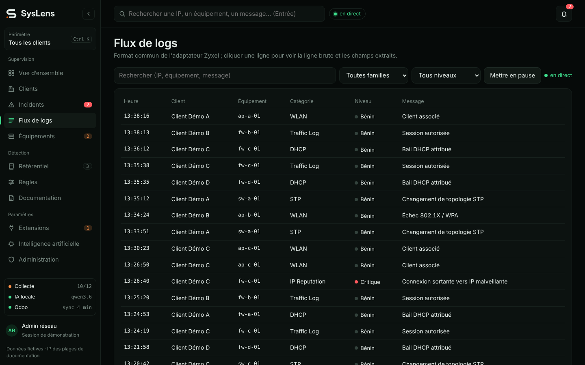
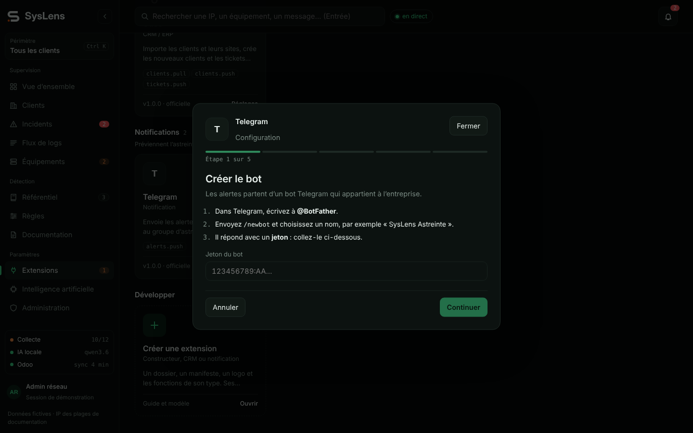

<p align="center">
  <picture>
    <source media="(prefers-color-scheme: dark)" srcset="medias/logo-sombre.svg">
    
  </picture>
</p>

<p align="center"></p>

# SysLens

SysLens reçoit les logs des équipements réseau d'un parc de clients, note chaque log de 0 à 100 et regroupe ce qui compte en incidents, avec le détail du calcul. Zyxel d'abord ; les autres marques arrivent sous forme d'extensions.

- **Note déterministe.** Un référentiel construit à partir de la documentation du constructeur, puis des modificateurs fixes : pare-feu de tête, source publique, répétition, hors plage ouvrée, même source vue chez plusieurs clients. Mêmes entrées, même note, et chaque incident montre son calcul.
- **Quatre niveaux.** Bénin (moins de 30), moyen (30), grave (60), critique (85). Les relevés de routine (statistiques d'interfaces, charge, paquets bloqués par la règle par défaut) restent bénins et n'ouvrent jamais d'incident.
- **IA au choix, jamais aux commandes.** Ollama, Mistral, ChatGPT, Claude, Gemini, Hermes ou Grok, par clé API ou avec un abonnement ChatGPT, Claude ou Google via Codex, Claude Code ou Gemini CLI. L'IA donne son avis sur les incidents moyens et graves ; les critiques partent sans l'attendre, et une IA hors du réseau reste coupée pour un client tant qu'il ne l'a pas autorisée par écrit (RGPD, art. 28).
- **Pensé pour un grand parc.** Les clients viennent du CRM (extension Odoo, avec règles d'import), le choix du client passe par une recherche, et un équipement qui se tait ouvre un incident.
- **Extensions.** Constructeurs, CRM et notifications (Telegram, mail) se branchent par un manifeste et se configurent pas à pas, une question par écran.
- **Mise à jour automatique** depuis les releases de ce dépôt, fichiers vérifiés par empreinte.

## Aperçu

<table>
<tr><td align="center" width="50%"><br><sub>Vue d'ensemble</sub></td><td align="center" width="50%"><br><sub>Incident et calcul du score</sub></td></tr>
<tr><td align="center" width="50%"><br><sub>Flux de logs</sub></td><td align="center" width="50%"><br><sub>Extensions</sub></td></tr>
<tr><td align="center" width="50%"><br><sub>Configuration pas à pas</sub></td><td align="center" width="50%"><br><sub>Fournisseurs d’IA</sub></td></tr>
</table>

## Installation

Node.js 20 ou plus, rien d'autre.

```bash
git clone https://github.com/Nesaris/SysLens && cd SysLens
ALLOW=192.168.1.0/24 node syslens.js
```

La console s'ouvre sur <http://localhost:8514/console>. Elle n'écoute que sur la machine elle-même (127.0.0.1).

Le port 514 est privilégié sur Linux : lancer avec les droits nécessaires, ou autoriser Node une fois avec `sudo setcap cap_net_bind_service=+ep "$(command -v node)"`. Sur macOS, le port 514 s'ouvre sans droits particuliers tant que SysLens écoute sur toutes les interfaces (c'est le cas par défaut).

### Réglages

| Variable | Rôle | Par défaut |
|---|---|---|
| `PORT` | Port syslog, en UDP et en TCP | `514` |
| `BIND` | Adresse d'écoute du syslog | `0.0.0.0` |
| `WEB` | Port de la console (127.0.0.1 seulement) | `8514` |
| `ALLOW` | Sources acceptées, en CIDR séparés par des virgules ; le reste est ignoré et compté | toutes |
| `RETENTION_DAYS` | Jours de logs gardés ; les jours passés sont compressés, les plus vieux supprimés | `90` |
| `WORKERS` | Processus de réception en plus, pour les très gros parcs | `0` |
| `RAW_GZIP` | `0` pour écrire le brut sans compression | compressé |
| `SYSLENS_AUTOUPDATE` | `0` pour couper la mise à jour automatique | activée |
| `SYSLENS_REPO` | Dépôt dont les releases sont suivies | `Nesaris/SysLens` |
| `SYSLENS_TEAMS_WEBHOOK` | Adresse du flux Teams, si le trousseau macOS n'est pas disponible | — |
| `SYSLENS_WHATSAPP_TOKEN` | Jeton WhatsApp Business, si le trousseau macOS n'est pas disponible | — |
| `SYSLENS_DOCS` | `0` pour couper la recherche de la documentation des modèles | activée |

Mettez toujours `ALLOW` sur un réseau partagé : sans lui, n'importe quelle machine peut injecter des logs.

## Côté Zyxel

Sur un pare-feu ZLD (USG FLEX, ATP, USG) :

1. *Configuration › Log & Report › Log Settings*, ligne **Remote Server 1**, puis *Edit*.
2. **Active**, format **CEF/Syslog** (le format Syslog simple écrit l'année hors de la norme RFC 3164), adresse de la machine SysLens, port 514, facility **Local 1**.
3. Catégories en « normal » ; *Traffic Log* sur « disable », sauf si le contrat du client le demande.
4. *OK*, puis *Apply*.

Réglez aussi l'heure (NTP et fuseau) : SysLens horodate chaque log à la réception, mais une heure fausse sur l'équipement gêne la lecture des logs bruts.

## Comptes et assistant

Au premier lancement, la console demande de créer le compte administrateur (depuis le poste où tourne SysLens). Ensuite, chacun se connecte avec son compte ; l'administrateur crée les comptes des techniciens dans Réglages, avec un mot de passe provisoire à changer à la première connexion. Clôtures d'incidents et validations du référentiel sont enregistrées au nom de la personne.

Le bouton **Assistant**, en bas à droite, ouvre une conversation avec l'IA configurée dans Paramètres › Intelligence artificielle (par exemple qwen3:8b avec Ollama, sur le même poste). L'assistant voit l'état actuel de SysLens : équipements, incidents des 7 derniers jours, nombre de logs. Chaque conversation n'est visible que par la personne qui l'a ouverte. Dans « À traiter maintenant », **Demander à l'assistant** lui pose directement la question sur un incident.

## Référentiel

`referentiel.json` décrit les logs Zyxel connus (pare-feu ZLD et uOS, switchs, bornes, Nebula) : catégorie, message, note de base, plancher, signification et action. L'ordre fait la priorité : la première entrée qui correspond note le log.

Chaque type reçu est classé :

- **règle précise** : une entrée du référentiel le décrit ;
- **catégorie connue** : seule sa catégorie est connue, et sa gravité est faible ;
- **type appris** : classé par l'IA ou par un technicien, puis validé (`logs/ref-appris.json`) ;
- **à qualifier** : rien ne le décrit, ou sa catégorie seule ne suffit pas (gravité error ou plus). Il est noté avec la gravité annoncée par l'équipement, grave au plus.

Les types à qualifier sont envoyés à l'IA choisie dans la console, par lots de 25, sous forme de gabarits : adresses IP et MAC, comptes, noms de machine et de domaine sont masqués. Tant qu'un technicien ne l'a pas validée, une proposition de l'IA peut monter la note (grave au plus), jamais la baisser.

### Apprentissage

- Chaque validation ou correction d'un technicien est gardée et sert d'exemple à l'IA. Pour chaque type à noter, SysLens lui montre les types déjà validés qui lui ressemblent le plus (mêmes mots dans la catégorie et le message), avec la correction quand le technicien a changé sa note.
- L'IA reçoit aussi le barème du centre : les ~30 entrées du référentiel les plus proches des types à noter, avec leur note (corrigée s'il y a lieu).
- **Autonomie** (Référentiel › Apprentissage de l'IA, désactivée par défaut) : quand l'IA est d'accord avec les techniciens au moins 9 fois sur les 10 dernières décisions (10 minimum), elle valide seule ses propositions sûres (confiance ≥ 0,7). Elle ne baisse jamais seule sous 30 un log que l'équipement annonce alert ou pire. Les validations automatiques ne comptent pas dans le taux d'accord.
- **Entraînement au repos** (activé par défaut avec le classement en continu) : quand il n'y a rien à classer, l'IA s'exerce par séances de 6 sur des types dont la note est connue : types validés par un technicien, types reconnus par le référentiel. La réponse lui est cachée (l'exercice n'est ni dans ses exemples ni dans son barème). Ses erreurs sont gardées et lui sont remontrées comme exemples corrigés quand un type à noter leur ressemble ; son biais sur les 300 derniers exercices lui est rappelé dans la consigne, par niveau dès 7 points (une IA surnote souvent la routine et sous-note le grave, ce qui s'annule dans la moyenne), sinon en tout dès 5 points. Une erreur est reposée 1 h plus tard, une réussite 7 jours plus tard. Elle relit aussi une fois ses propositions de plus de 6 h : si elle change d'avis, la proposition est marquée « avis instable », sans que sa note change. Le repos : rien à classer, aucune recherche de documentation, personne en train d'écrire à l'assistant depuis 3 min, charge de la machine sous 70 %. Une séance toutes les 5 min au plus, 30 min de pause après une erreur de l'IA. Les résultats de l'entraînement ne comptent pas pour l'autonomie.
- **Classement en continu** : avec une IA locale (Ollama sur ce poste), le serveur classe les nouveaux types toutes les 2 minutes, même console fermée. Une IA en ligne ne peut pas servir ici, puisque sa clé ne quitte pas le navigateur.
- Avec Ollama, SysLens coupe la phase de réflexion des modèles qui en ont une (qwen3…) impose un schéma JSON, borne la longueur de la réponse et garde le modèle chargé 30 minutes : un lot de 8 types prend environ 35 à 40 s avec qwen3:8b sur un Mac M5 de 16 Go. Prévoir 8 Go de mémoire libre pour un modèle 8B : en dessous, le système passe sur le disque et un lot peut prendre plusieurs minutes.

### Formation des IA et centre de formation

`formation.json` livre un corpus de logs Zyxel d'exemple (aucune donnée client), les compétences de l'IA et les règles que SysLens applique quel que soit le modèle.

- **Formation** (Paramètres › Intelligence artificielle) : toute IA passe le même examen de 24 logs dont la bonne note vient du référentiel ; la règle qui décrit chaque log lui est cachée. La fiche (prête, utilisable, pas adaptée) règle ensuite ce modèle seulement : lots de 12 types, ou de 3 si ses réponses ne sont pas toujours lisibles, rappel de son biais par niveau, erreurs remontrées comme exemples corrigés. Elle se lance seule à l'ajout d'une IA locale.
- **Centre de formation** (Paramètres) : bac à sable de 1 à 48 h (12 h par défaut), sans effet sur les vrais incidents. Sept situations, corrigées d'après le référentiel : noter un log, ne pas surnoter une fausse alerte, repérer et corriger une note fausse, trouver la cause et choisir l'action (choix multiples), choisir l'incident urgent parmi cinq sur un site qui déborde, résister à une consigne glissée dans un log. Une erreur revient 10 min, 40 min, 2 h, 6 h puis 24 h plus tard ; chaque erreur devient un exemple corrigé pour ce modèle. Un examen de contrôle sur les 24 logs de la formation, jamais travaillés au centre, passe au départ, toutes les 2 h et à la fin. Avec une IA locale, les types réels du site reconnus par le référentiel s'ajoutent au corpus ; avec une IA en ligne, seul le corpus d'exemple sert (chaque situation est un appel facturé). Les vrais logs et l'assistant passent avant ; la formation reprend seule après un redémarrage avec une IA locale.

### Documentation des modèles

Dès qu'un équipement envoie ses premiers logs, SysLens cherche la documentation de son modèle dans la bibliothèque officielle de Zyxel (`www.zyxel.com`, fichiers sur `download.zyxel.com`) : le guide utilisateur et le guide des commandes. Un document n'est accepté que s'il passe cinq contrôles :

1. téléchargé en HTTPS depuis le site officiel, sans redirection vers un autre site ;
2. rangé dans le dossier du modèle sur `download.zyxel.com` ;
3. vrai PDF ;
4. bon type de guide sur la couverture (User's Guide, CLI Reference Guide) ;
5. série du modèle sur la couverture (par exemple « GS1350 Series » pour un GS1350-26HP).

SysLens note aussi le nombre de fois où le modèle exact est cité, la version du guide et son empreinte SHA-256. Il garde le texte, page par page, dans `logs/docs/` (PDFKit sur macOS, `pdftotext` s'il est installé, sinon son propre lecteur) et ne garde pas le PDF.

Ensuite, quand l'IA classe un type de log de ce modèle, elle reçoit la page du guide qui en parle le plus (sommaire et index écartés). L'extrait lui est donné comme une donnée : une consigne écrite dans un document n'est pas suivie, et les garde-fous habituels s'appliquent (une proposition non validée ne baisse jamais une note). La proposition garde le lien vers la page du guide.

Un modèle introuvable (modèle Nebula seul, nom d'équipement qui n'est pas un modèle) est recherché de nouveau 7 jours plus tard, une erreur réseau 6 heures plus tard. Quand les logs ne donnent pas le modèle, il se saisit dans Équipements. Seul le nom du modèle part vers Zyxel.

### Banc d'essai de l'IA

`SYSLENS_EVAL=1` lance SysLens en mode banc d'essai : le référentiel ne note plus rien (tout passe « à qualifier »), il sert seulement de barème à l'IA, sans jamais lui montrer la règle qui décrit le log testé. On compare ensuite les notes de l'IA à celles du référentiel. À ne pas utiliser en production.

## Données

Tout reste sur la machine :

- `logs/raw-AAAA-MM-JJ.log.gz` : toutes les lignes reçues, telles quelles, compressées au fil de l'eau (`zcat` pour les lire) ;
- `logs/events-AAAA-MM-JJ.jsonl` : les événements utiles (référentiel, ou gravité moyen et plus), décodés, notés, avec leur ligne brute ;
- `logs/types.json` : tous les types de logs vus depuis l'installation, avec leur couverture ;
- `logs/compteurs.json` : le nombre de logs reçus par tranche de 5 minutes et par niveau, sur 7 jours ;
- `logs/incidents-etat.json` : les incidents acquittés ou clos par un admin (avec un résumé pour l’onglet Archivés), gardés 13 mois ;
- `logs/comptes.json`, `logs/sessions.json` : les comptes (mots de passe hachés) et les sessions ouvertes ;
- `logs/conversations/` : les conversations avec l'assistant, un fichier par compte ;
- `logs/adresses.json` : l'adresse IP des switchs et bornes derrière un pare-feu, apprise de ses logs DHCP, pour les pinger quand ils se taisent ;
- `logs/ref-appris.json` : les types classés par l'IA ou un technicien, et les notes de base corrigées.

Ces fichiers contiennent des adresses IP et des identifiants des clients : le `.gitignore` les tient hors du dépôt, et rien n'est envoyé ailleurs. Les logos des extensions sont récupérés une fois sur le site officiel de chaque marque et gardés dans `extensions/` ; ils ne sont pas redistribués avec le code.

## Capacité

Mesuré sur une machine à 2 cœurs (qui envoyait aussi les logs) : **35 000 logs/s par processus** en UDP, brut compressé compris, sans perte jusqu'à 23 000 logs/s envoyés en rafales. Un pare-feu Zyxel exposé à Internet envoie environ 1,3 log/s : un processus suit donc plus de 10 000 pare-feu. Au-delà, `WORKERS` ajoute des processus de réception, un par cœur libre.

Les rafales sont absorbées par le tampon de réception UDP : SysLens prend le plus grand que le système accepte et l'affiche au démarrage (`Tampon UDP : 8.0 Mo`). Sous 4 Mo, des logs peuvent se perdre en rafale. Pour l'agrandir : sur Linux `sudo sysctl -w net.core.rmem_max=33554432` ; sur macOS `sudo sysctl -w kern.ipc.maxsockbuf=33554432`.

- Seuls les événements utiles remontent au processus principal (incidents, console, IA) ; les bénins sont comptés, archivés et échantillonnés pour le flux de la console.
- Les incidents sont regroupés côté serveur (`/api/incidents`), par type, équipement et source.
- Les équipements derrière une même IP (routeur et switch d'un site en NAT) sont séparés par leur nom d'hôte.
- Disque : sur un vrai pare-feu, le brut se compresse environ 40 fois. Comptez de l'ordre de 7 Go par jour pour 10 000 pare-feu bavards, beaucoup moins avec le *Traffic Log* coupé.

## Mises à jour

Toutes les heures, SysLens demande à GitHub la dernière release du dépôt. Si elle est plus récente :

1. il télécharge les fichiers listés dans `SHA256SUMS` à ce tag et vérifie chacun ; un seul écart, et rien n'est remplacé ;
2. il démarre la nouvelle version en essai (`node syslens.js --selftest`) ;
3. il range la version en place dans `.previous/`, remplace les fichiers et redémarre dans le même terminal ;
4. la console ouverte se recharge seule (ou propose de le faire si un formulaire est en cours).

La page *Administration* montre la version installée, la dernière release, les nouveautés et un bouton « Vérifier maintenant ». Pour revenir en arrière : copier le contenu de `.previous/` à la place des fichiers, puis relancer.

### Publier une version

1. Ajouter l'entrée de la version en tête de `nouveautes.json`.
2. `./release.sh 0.3.0 "Ce qui change"` : met `package.json` à jour, lance les essais, calcule `SHA256SUMS`, commite en UTC, tague, pousse et crée la release.

Tout ce qui est publié en release s'exécute ensuite sur chaque installation : la double authentification doit être exigée sur l'organisation et la branche `main` protégée.

## Développement

```bash
npm test
```

Les essais démarrent de vrais serveurs SysLens, leur envoient du vrai syslog en UDP et vérifient la note, le filtre des sources, les refus des appels venus d'autres sites et la mise à jour complète contre un faux GitHub, y compris le refus d'un fichier altéré. La vérification continue (`.github/workflows/verification.yml`) ajoute la recherche de secrets dans l'historique, l'identité des commits et l'analyse statique.

## Licence

[MIT](LICENSE) — fait par [CodeX64](https://codexx64.github.io).
