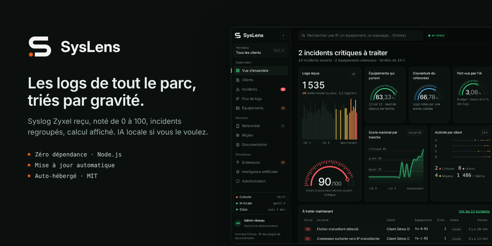
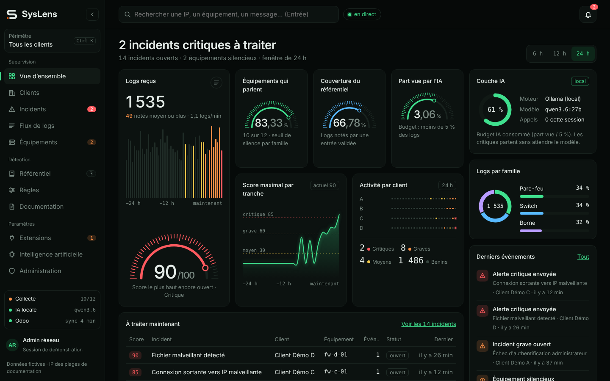
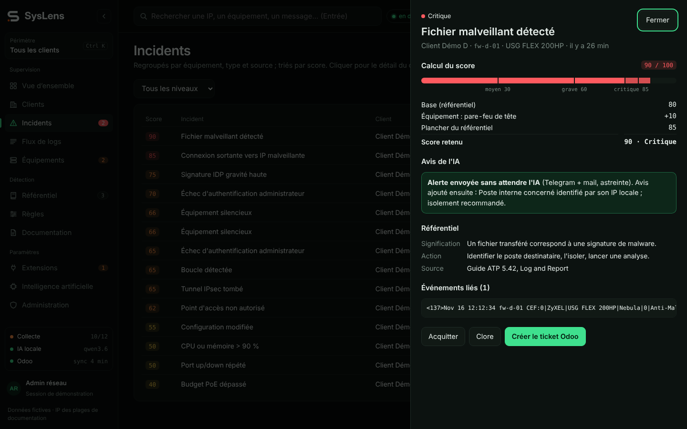
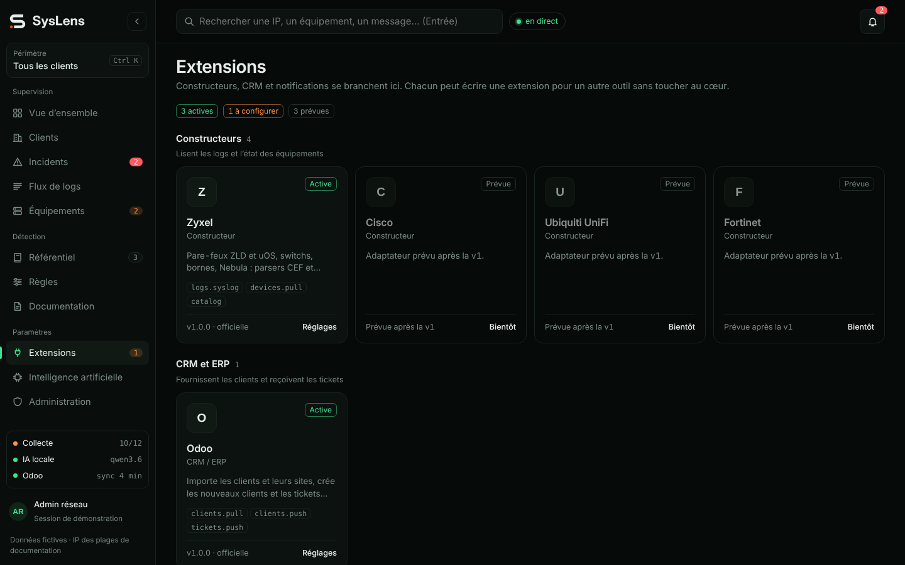

<p align="center">
  <picture>
    <source media="(prefers-color-scheme: dark)" srcset="medias/logo-sombre.svg">
    
  </picture>
</p>

<p align="center"></p>

# SysLens

SysLens reçoit les logs des équipements réseau d'un parc de clients, note chaque log de 0 à 100 et regroupe ce qui compte en incidents, avec le détail du calcul. Zyxel d'abord ; les autres marques arrivent sous forme d'extensions.

- **Note déterministe.** Un référentiel construit à partir de la documentation du constructeur, puis des modificateurs fixes : pare-feu de tête, source publique, répétition, hors plage ouvrée, même source vue chez plusieurs clients. Mêmes entrées, même note, et chaque incident montre son calcul.
- **Quatre niveaux.** Bénin (moins de 30), moyen (30), grave (60), critique (85). Les relevés de routine (statistiques d'interfaces, charge, paquets bloqués par la règle par défaut) restent bénins et n'ouvrent jamais d'incident.
- **IA au choix, jamais aux commandes.** Un modèle local (Ollama) donne son avis sur les incidents moyens et graves ; les critiques partent sans l'attendre. Une IA en nuage reste bloquée tant qu'un client ne l'a pas autorisée par écrit (RGPD, art. 28).
- **Pensé pour un grand parc.** Les clients viennent du CRM (extension Odoo, avec règles d'import), le choix du client passe par une recherche, et un équipement qui se tait ouvre un incident.
- **Extensions.** Constructeurs, CRM et notifications (Telegram, mail) se branchent par un manifeste et se configurent pas à pas, une question par écran.
- **Mise à jour automatique** depuis les releases de ce dépôt, fichiers vérifiés par empreinte.

## Aperçu

<table>
<tr><td align="center" width="50%"><br><sub>Vue d'ensemble</sub></td><td align="center" width="50%"><br><sub>Incident et calcul du score</sub></td></tr>
<tr><td align="center" width="50%"><br><sub>Flux de logs</sub></td><td align="center" width="50%"><br><sub>Extensions</sub></td></tr>
<tr><td align="center" width="50%"><br><sub>Configuration pas à pas</sub></td></tr>
</table>

## Installation

Node.js 20 ou plus, rien d'autre.

```bash
git clone https://github.com/Nesaris/SysLens && cd SysLens
ALLOW=192.168.1.0/24 node syslens.js
```

La console s'ouvre sur <http://localhost:8514/console>. Elle n'écoute que sur la machine elle-même (127.0.0.1).

Le port 514 est privilégié sur Linux : lancer avec les droits nécessaires, ou autoriser Node une fois avec `sudo setcap cap_net_bind_service=+ep "$(command -v node)"`. Sur macOS, le port 514 s'ouvre sans droits particuliers tant que SysLens écoute sur toutes les interfaces (c'est le cas par défaut).

### Réglages

| Variable | Rôle | Par défaut |
|---|---|---|
| `PORT` | Port syslog, en UDP et en TCP | `514` |
| `BIND` | Adresse d'écoute du syslog | `0.0.0.0` |
| `WEB` | Port de la console (127.0.0.1 seulement) | `8514` |
| `ALLOW` | Sources acceptées, en CIDR séparés par des virgules ; le reste est ignoré et compté | toutes |
| `SYSLENS_AUTOUPDATE` | `0` pour couper la mise à jour automatique | activée |
| `SYSLENS_REPO` | Dépôt dont les releases sont suivies | `Nesaris/SysLens` |

Mettez toujours `ALLOW` sur un réseau partagé : sans lui, n'importe quelle machine peut injecter des logs.

## Côté Zyxel

Sur un pare-feu ZLD (USG FLEX, ATP, USG) :

1. *Configuration › Log & Report › Log Settings*, ligne **Remote Server 1**, puis *Edit*.
2. **Active**, format **CEF/Syslog** (le format Syslog simple écrit l'année hors de la norme RFC 3164), adresse de la machine SysLens, port 514, facility **Local 1**.
3. Catégories en « normal » ; *Traffic Log* sur « disable », sauf si le contrat du client le demande.
4. *OK*, puis *Apply*.

Réglez aussi l'heure (NTP et fuseau) : SysLens horodate chaque log à la réception, mais une heure fausse sur l'équipement gêne la lecture des logs bruts.

## Données

Tout reste sur la machine :

- `logs/raw-AAAA-MM-JJ.log` : les lignes reçues, telles quelles ;
- `logs/events-AAAA-MM-JJ.jsonl` : les mêmes, décodées et notées ;
- `logs/types.json` : les types de logs vus, pour enrichir le référentiel.

Ces fichiers contiennent des adresses IP et des identifiants des clients : le `.gitignore` les tient hors du dépôt, et rien n'est envoyé ailleurs. Les logos des extensions sont récupérés une fois sur le site officiel de chaque marque et gardés dans `extensions/` ; ils ne sont pas redistribués avec le code.

## Mises à jour

Toutes les heures, SysLens demande à GitHub la dernière release du dépôt. Si elle est plus récente :

1. il télécharge les fichiers listés dans `SHA256SUMS` à ce tag et vérifie chacun ; un seul écart, et rien n'est remplacé ;
2. il démarre la nouvelle version en essai (`node syslens.js --selftest`) ;
3. il range la version en place dans `.previous/`, remplace les fichiers et redémarre dans le même terminal ;
4. la console ouverte se recharge seule (ou propose de le faire si un formulaire est en cours).

La page *Administration* montre la version installée, la dernière release, les nouveautés et un bouton « Vérifier maintenant ». Pour revenir en arrière : copier le contenu de `.previous/` à la place des fichiers, puis relancer.

### Publier une version

1. Ajouter l'entrée de la version en tête de `nouveautes.json`.
2. `./release.sh 0.3.0 "Ce qui change"` : met `package.json` à jour, lance les essais, calcule `SHA256SUMS`, commite en UTC, tague, pousse et crée la release.

Tout ce qui est publié en release s'exécute ensuite sur chaque installation : la double authentification doit être exigée sur l'organisation et la branche `main` protégée.

## Développement

```bash
npm test
```

Les essais démarrent de vrais serveurs SysLens, leur envoient du vrai syslog en UDP et vérifient la note, le filtre des sources, les refus des appels venus d'autres sites et la mise à jour complète contre un faux GitHub, y compris le refus d'un fichier altéré. La vérification continue (`.github/workflows/verification.yml`) ajoute la recherche de secrets dans l'historique, l'identité des commits et l'analyse statique.

## Licence

[MIT](LICENSE) — fait par [CodeX64](https://codexx64.github.io).
