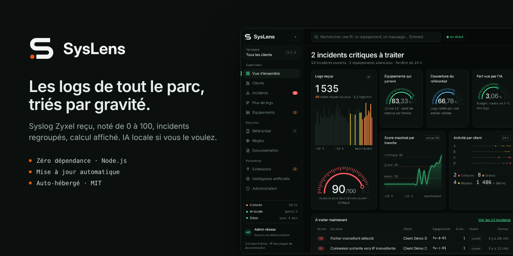
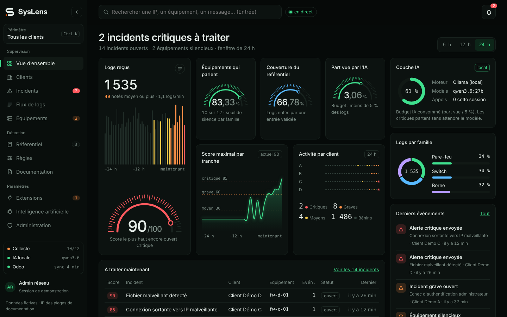
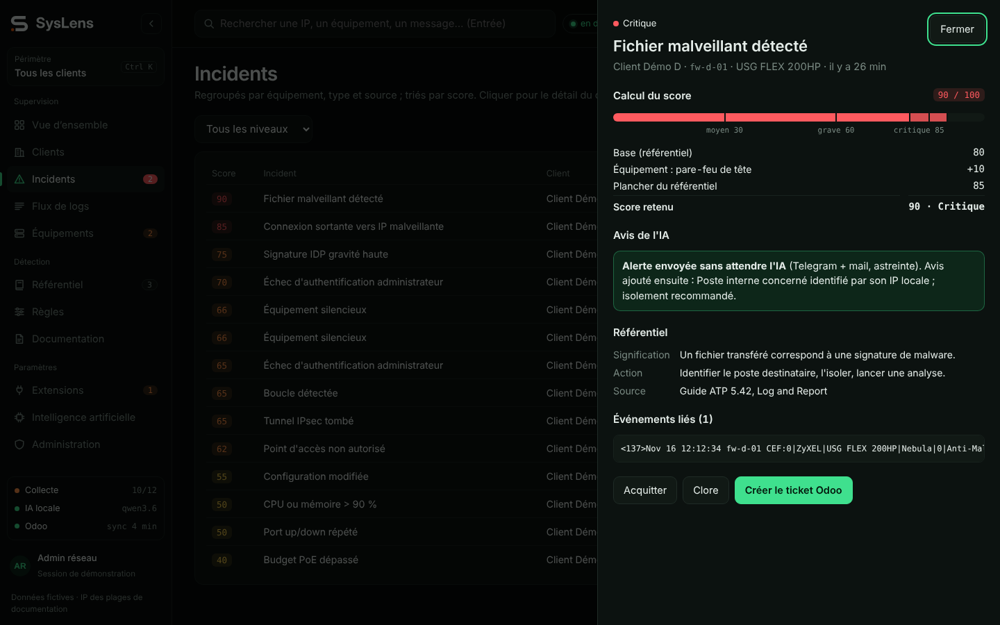
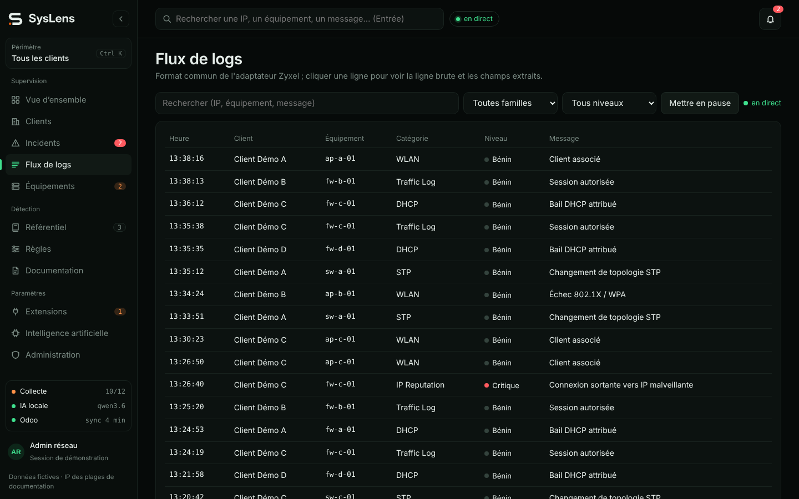
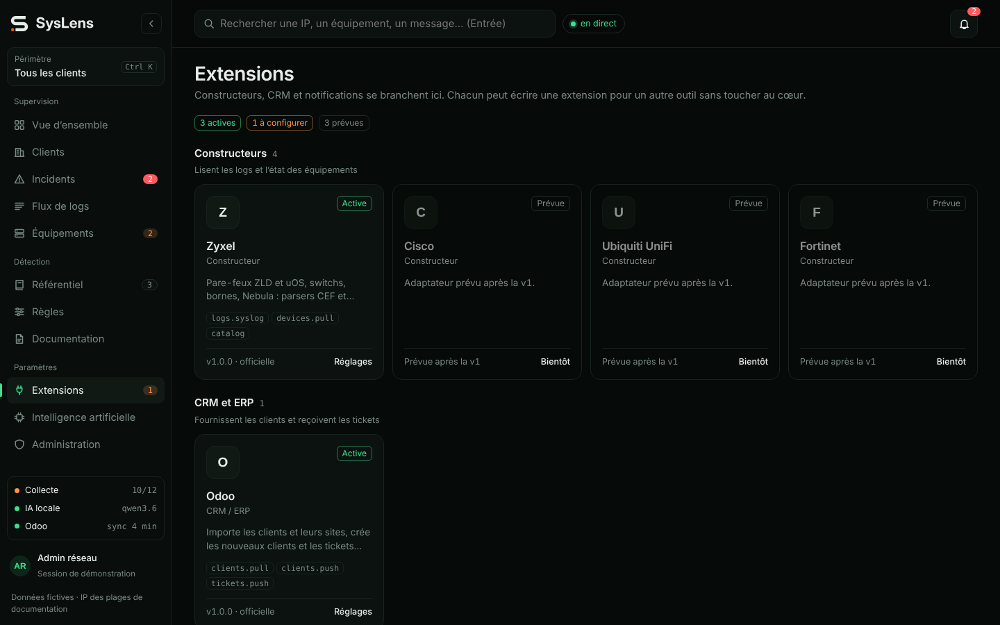
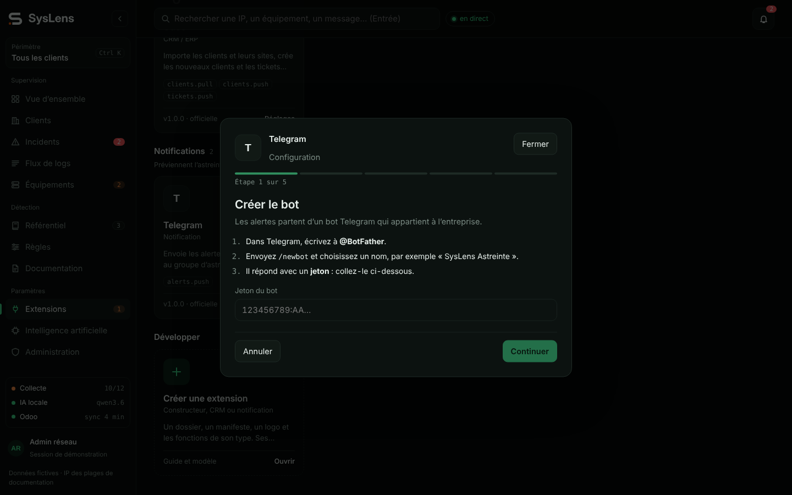
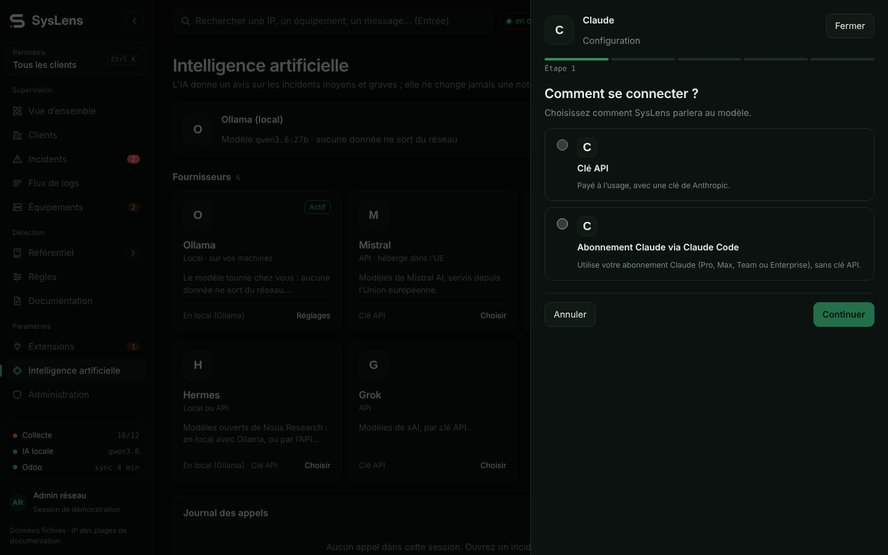

<p align="center">
  <picture>
    <source media="(prefers-color-scheme: dark)" srcset="medias/logo-sombre.svg">
    
  </picture>
</p>

<p align="center"></p>

# SysLens

**Collects the logs of every network device you manage, scores each one from 0 to 100 and groups them into incidents, with the calculation shown. Zyxel first, other vendors as extensions.**

<p align="center">

[](https://github.com/Nesaris/SysLens/stargazers)
[](LICENSE)


</p>

<p align="center"><a href="README.fr.md">🇫🇷 Documentation complète en français</a> · <a href="https://nesaris.github.io">Nesaris Network</a></p>

## Why SysLens?

When you look after the network of dozens or hundreds of clients, the logs are there, but nobody reads them. SysLens reads them for you: it keeps what matters, tells you how serious it is and why, and stays quiet about the rest.

## Features

- **Deterministic scoring.** A reference catalogue built from the vendor documentation, plus fixed modifiers (head-end firewall, public source, repetition, out-of-hours, correlation across clients). Same input, same score, and every incident shows how its score was computed.
- **Zyxel first.** ZLD and uOS firewalls (USG FLEX, ATP), switches, access points and Nebula. CEF and plain syslog, UDP and TCP.
- **AI of your choice, never in charge.** Ollama, Mistral, ChatGPT, Claude, Gemini, Hermes or Grok — by API key, or with a ChatGPT, Claude or Google subscription through Codex, Claude Code or Gemini CLI. The AI gives an opinion on medium and serious incidents; critical ones are sent without waiting for it, and cloud AI stays off for a client until they have agreed in writing (GDPR).
- **Built for large fleets.** Clients come from your CRM (Odoo extension, with import rules), the client picker scales to thousands, and silent devices raise an incident.
- **Extensions.** Vendors, CRM and notifications (Telegram, mail) plug in through a manifest and are configured step by step.
- **Updates itself.** Every hour it checks this repository's releases, verifies each file against `SHA256SUMS`, test-starts the new version, keeps the previous one and restarts.

## Screenshots

<table>
<tr><td align="center" width="50%"><br><sub>Overview</sub></td><td align="center" width="50%"><br><sub>Incident and score breakdown</sub></td></tr>
<tr><td align="center" width="50%"><br><sub>Log stream</sub></td><td align="center" width="50%"><br><sub>Extensions</sub></td></tr>
<tr><td align="center" width="50%"><br><sub>Step-by-step configuration</sub></td><td align="center" width="50%"><br><sub>AI providers</sub></td></tr>
</table>

## Quick start

```bash
git clone https://github.com/Nesaris/SysLens && cd SysLens
ALLOW=192.168.1.0/24 node syslens.js     # only accept logs from your devices
```

Then open <http://localhost:8514/console>. On the Zyxel side: *Log & Report → Log Settings → Remote Server*, format **CEF/Syslog**, port 514.

Full documentation (settings, Zyxel configuration, updates, data) is in **[README.fr.md](README.fr.md)** (French).

## Part of Nesaris Network

SysLens is one of the self-hosted tools of **[Nesaris Network](https://nesaris.github.io)**. It runs on Node.js with **zero npm dependencies**.

Other projects: [Hub](https://github.com/Nesaris/Hub) · [Vigie](https://github.com/Nesaris/Vigie) · [MapMyLAN](https://github.com/Nesaris/MapMyLAN) · [NexArc](https://github.com/Nesaris/NexArc) · [ProxLab](https://github.com/Nesaris/ProxLab) · [Relay](https://github.com/Nesaris/Relay) · [Nesmail](https://github.com/Nesaris/Nesmail) · [Synapse](https://github.com/Nesaris/Synapse) · [Dialekt](https://github.com/Nesaris/Dialekt)

## Contributing

Issues and pull requests are welcome. If SysLens is useful to you, a ⭐ helps a lot — it's how other people find the project.

## License

[MIT](LICENSE) — made by [CodeX64](https://codexx64.github.io).
